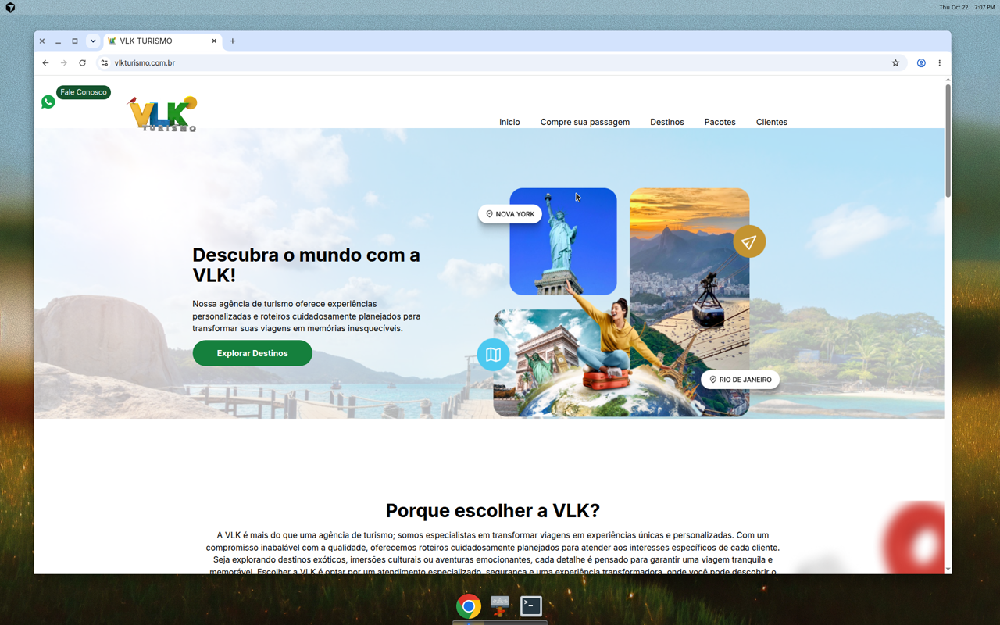

# VLK Turismo

Site oficial da **VLK Turismo** — agência de viagens completa com catálogo de pacotes
nacionais e internacionais, sistema de venda de passagens integrado e área
administrativa protegida. Acesse em [vlkturismo.com.br](https://vlkturismo.com.br).



## Funcionalidades

| Módulo | O que faz | Backend |
|---|---|---|
| **Homepage** `/` | Carrossel de depoimentos de clientes, pacotes em destaque, seção de benefícios e apresentação da agência | Supabase |
| **Pacotes Nacionais** `/` | Lista de pacotes para destinos dentro do Brasil, carregados dinamicamente da tabela `pacotes` | Supabase |
| **Pacotes Internacionais** `/` | Lista de pacotes para destinos internacionais, carregados dinamicamente da tabela `pacotes` | Supabase |
| **Passagens** `/passagem` | Incorpora o sistema externo de venda de passagens (iframe para plataforma parceira) | Externo |
| **Botão WhatsApp** | Botão flutuante fixo "Fale Conosco" que abre conversa direta no WhatsApp da agência | — |
| **Login** `/login` | Autenticação de funcionários via Supabase Auth | Supabase |
| **Cadastro de Pacote** `/cadastroPacote` | **(🔒 protegida)** Formulário para cadastrar novos pacotes turísticos com upload de imagem para Supabase Storage | Supabase |
| **Tabela de Pacotes** `/tabelaPacotes` | **(🔒 protegida)** Administração de pacotes cadastrados: visualizar, editar e deletar | Supabase |

🔒 = Rota protegida: requer autenticação via Supabase Auth

## Tecnologias Utilizadas

Stack verificado em [`package.json`](package.json):

- **React** `^18.3.1` — biblioteca para construção da interface
- **Vite** `^5.4.10` — bundler e dev server de alta performance
- **React Router DOM** `^6.28.0` — roteamento e navegação entre páginas
- **Supabase** `^2.46.1` — backend como serviço (autenticação, banco Postgres, storage)
- **Tailwind CSS** `^3.4.14` — framework CSS utility-first para estilização responsiva
- **React Slick** `^0.30.2` — carrossel de depoimentos
- **React Icons** `^5.3.0` — ícones (WhatsApp, menu, etc.)

## Como Rodar Localmente

### Pré-requisitos

- Node.js (versão 16 ou superior)
- npm ou yarn
- Conta no [Supabase](https://supabase.com) (gratuita)

### 1. Clone o repositório

```bash
git clone https://github.com/leonardorimes/vlk.git
cd vlk
```

### 2. Instale as dependências

```bash
npm install
```

### 3. Configure as variáveis de ambiente

Copie o arquivo `.env.example` para `.env`:

```bash
cp .env.example .env
```

Preencha com as credenciais do seu projeto Supabase (disponíveis em **Project Settings → API**):

```
VITE_SUPABASE_URL=https://seu-projeto.supabase.co
VITE_SUPABASE_KEY=sua-chave-anon-publica-aqui
```

⚠️ **Importante**: Nunca commite o arquivo `.env` com credenciais reais.

### 4. Configure o banco de dados Supabase

No painel do Supabase, crie a tabela `pacotes` com o seguinte schema:

**Tabela: `pacotes`**

| Coluna | Tipo | Descrição |
|---|---|---|
| `id` | `uuid` | Chave primária (gerada automaticamente) |
| `Pacote` | `text` | Nome do pacote |
| `Destino` | `text` | Destino da viagem |
| `Valor` | `numeric` | Preço do pacote |
| `Internacional` | `boolean` | `true` para internacional, `false` para nacional |
| `imagen` | `text` | URL da imagem no Supabase Storage |
| `created_at` | `timestamp` | Data de criação (gerada automaticamente) |

Configure também:
- **Authentication → Email** habilitado
- **Storage → bucket `imagens`** criado (público para leitura, protegido para escrita)

### 5. Inicie o servidor de desenvolvimento

```bash
npm run dev
```

O site abrirá em [http://localhost:5173](http://localhost:5173)

## Scripts Disponíveis

| Script | Comando | Descrição |
|---|---|---|
| **dev** | `npm run dev` | Inicia o servidor de desenvolvimento Vite |
| **build** | `npm run build` | Gera a build de produção na pasta `dist/` |
| **preview** | `npm run preview` | Visualiza a build de produção localmente |
| **lint** | `npm run lint` | Executa o ESLint para verificar o código |

## Estrutura de Pastas

```
vlk/
├── public/                    # Arquivos públicos estáticos
│   └── BACKGROUND.png         # Imagem de fundo da homepage
├── src/
│   ├── assets/
│   │   └── images/            # Imagens do projeto (logos, fotos)
│   ├── components/
│   │   ├── Home.jsx           # Página inicial
│   │   ├── Depoimentos.jsx    # Carrossel de depoimentos
│   │   ├── Nacionais.jsx      # Seção de pacotes nacionais
│   │   ├── Internacionais.jsx # Seção de pacotes internacionais
│   │   ├── ExternalPage.jsx   # Componente iframe para /passagem
│   │   ├── whats.jsx          # Botão flutuante do WhatsApp
│   │   ├── FormLogin.jsx      # Formulário de login
│   │   ├── CadastroPacote.jsx # Formulário de cadastro de pacotes (protegido)
│   │   ├── TabelaPacotes.jsx  # Tabela de administração de pacotes (protegido)
│   │   ├── ProtectedRoute.jsx # HOC para rotas protegidas
│   │   ├── AuthContext.jsx    # Contexto de autenticação
│   │   ├── Layout.jsx         # Layout com Header e Footer
│   │   ├── Header.jsx         # Cabeçalho do site
│   │   ├── Footer.jsx         # Rodapé do site
│   │   └── ...                # Outros componentes
│   ├── utils/
│   │   └── bancoPacotes.jsx   # Funções de integração com Supabase
│   ├── App.jsx                # Configuração de rotas
│   └── main.jsx               # Entry point da aplicação
├── .env.example               # Template de variáveis de ambiente
├── .gitignore                 # Arquivos ignorados pelo Git
├── package.json               # Dependências e scripts
├── vite.config.js             # Configuração do Vite
├── tailwind.config.js         # Configuração do Tailwind CSS
└── README.md                  # Este arquivo
```

## Deploy

O projeto pode ser facilmente hospedado em plataformas como:

- **Vercel** (recomendado para Vite + React)
- **Netlify**
- **Cloudflare Pages**

Todas detectam automaticamente projetos Vite. Lembre-se de:
1. Adicionar as variáveis de ambiente (`VITE_SUPABASE_URL` e `VITE_SUPABASE_KEY`) no painel de configuração
2. Configurar o Supabase para aceitar requisições do domínio de produção em **Authentication → URL Configuration**

## Autor

Desenvolvido por **Leonardo Rimes**

- GitHub: [@leonardorimes](https://github.com/leonardorimes)
- LinkedIn: [TODO: adicionar perfil LinkedIn]
- E-mail: [TODO: adicionar e-mail de contato]

## Licença

Este projeto está sob a licença MIT. Veja o arquivo [LICENSE](LICENSE) para mais detalhes.
